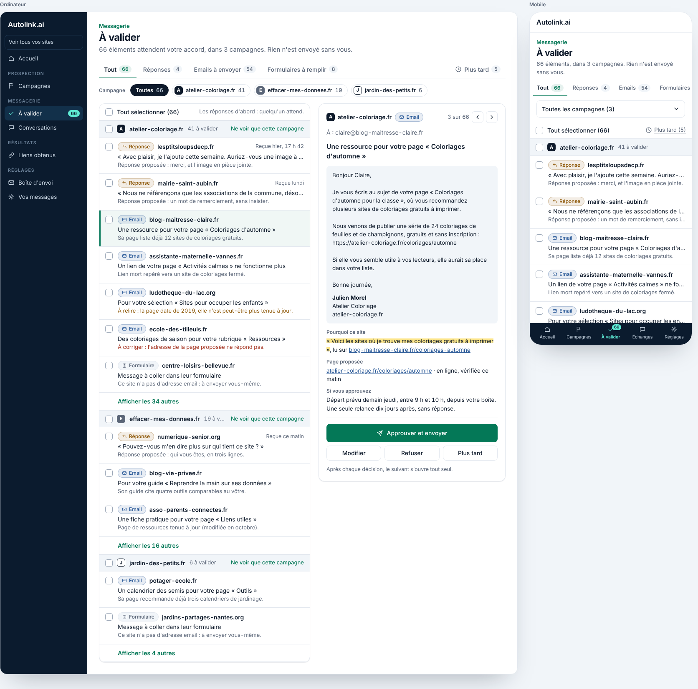
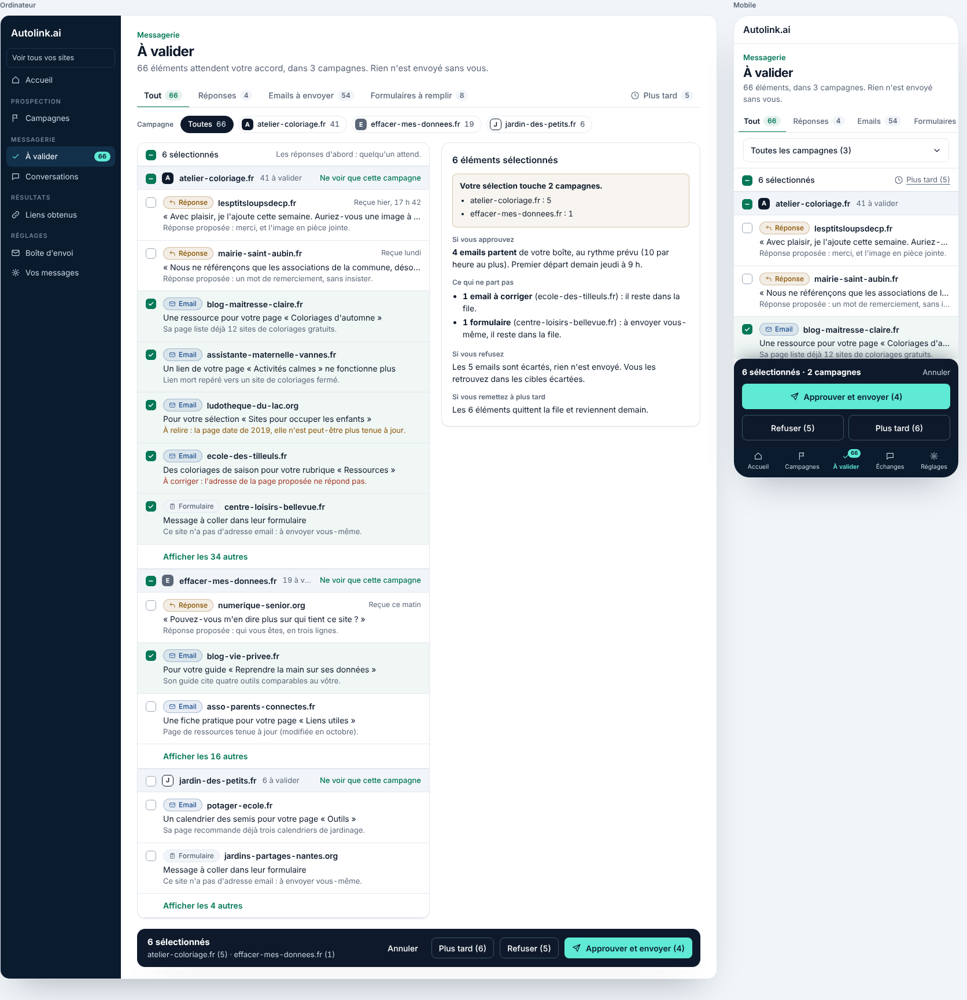
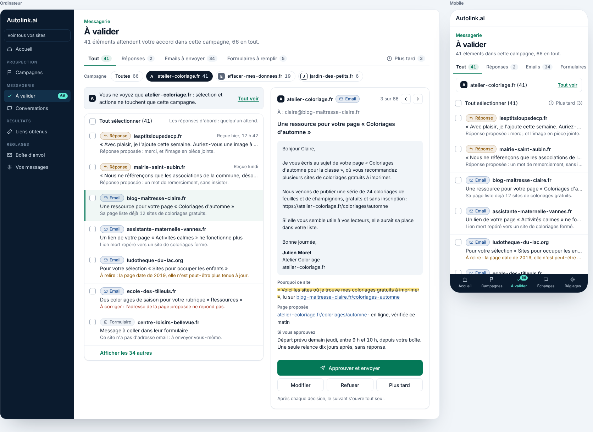
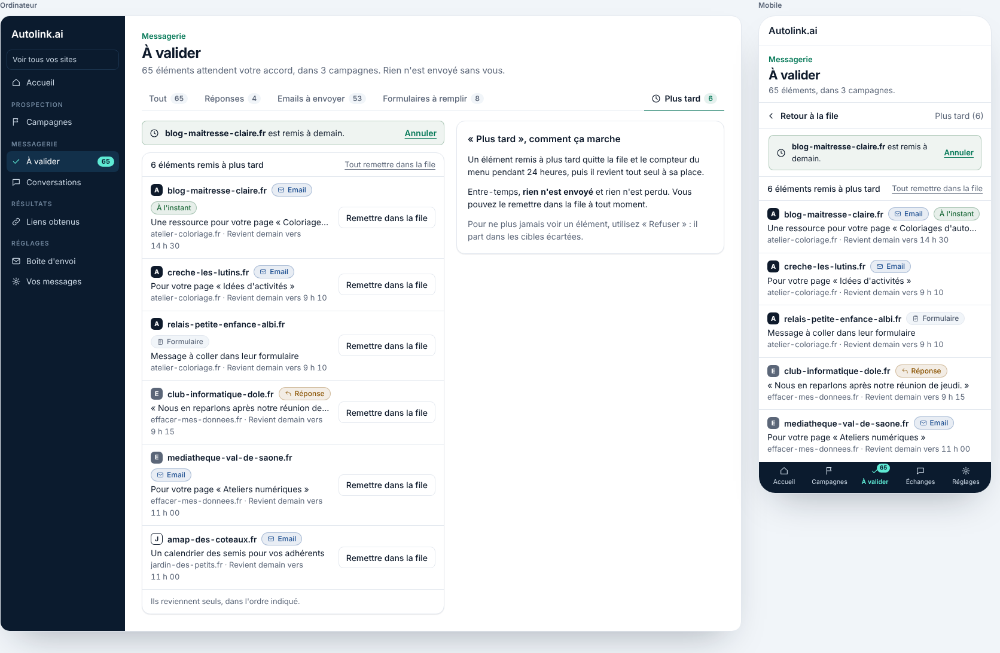
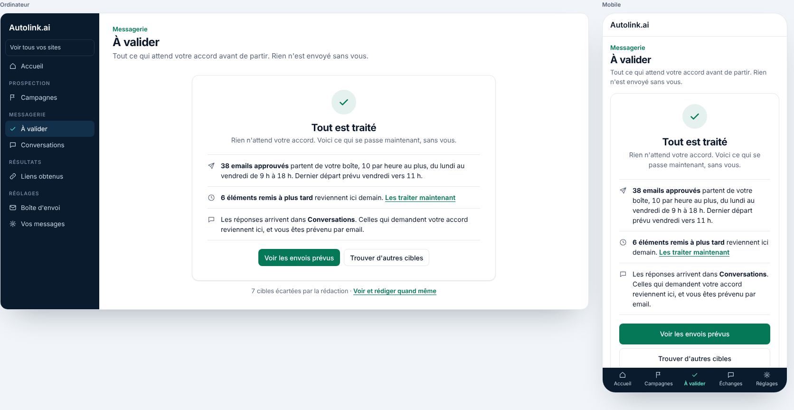
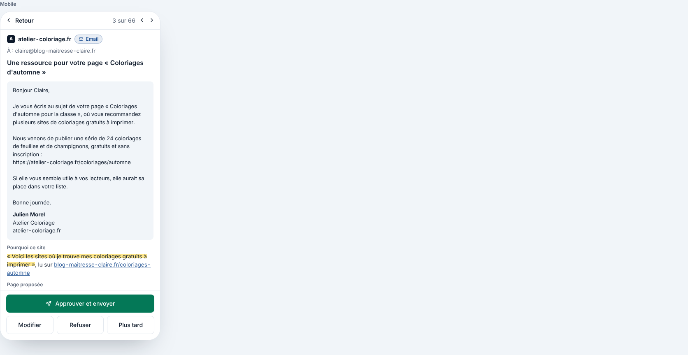
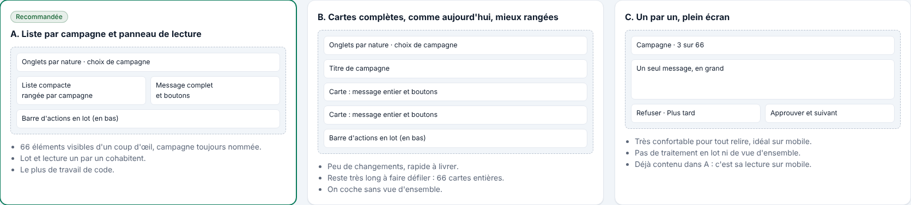

# Maquette « À valider » (18/11/2026)

Maquette à valider par Jonathan **avant tout code**. Fichier : `docs/mockups/a-valider.html` (à ouvrir dans un navigateur ; captures ci-dessous). Rien n'est branché, aucun fichier de `src/` n'est modifié. Données de démonstration : trois campagnes fictives, 66 éléments (4 réponses, 54 emails, 8 formulaires).

Point de départ : la page fusionnée dans `main` (`src/features/approvals/queue.tsx`), qui a déjà les filtres par nature, la sélection en lot (approuver, refuser, plus tard) et « Plus tard » durable sur 24 heures.

## Problèmes constatés sur la page actuelle

1. **La campagne se voit à peine.** Elle est écrite en gris après l'adresse du destinataire, et pas du tout sur les réponses. Les éléments sont rangés par nature (réponses, emails, formulaires), toutes campagnes mêlées : on peut approuver un message sans savoir pour quel site.
2. **66 cartes entières à faire défiler.** Chaque élément affiche tout le message, l'encadré d'explication et quatre ou cinq boutons. Pas de vue d'ensemble, et sur mobile la file fait des dizaines d'écrans.
3. **Deux façons d'approuver en masse.** Le bouton « Approuver et envoyer les N emails prêts » (en haut, un clic, toutes campagnes) et la barre de sélection. Le premier est le plus risqué et le plus visible.
4. **La barre de sélection reste en haut.** Dès qu'on descend dans la liste, on ne voit plus ni le nombre d'éléments cochés ni les boutons.
5. **Refuser en lot passe par une fenêtre du navigateur**, sans dire ce qui arrive aux éléments ni de quelles campagnes ils viennent.
6. **« Plus tard » est une boîte noire.** Un bandeau dit « 5 éléments remis à plus tard », sans montrer lesquels ni quand ils reviennent ; la seule action est de tout remettre d'un coup.
7. **La file vide est une phrase grise.** Elle ne dit pas ce qui se passe maintenant (envois prévus, réponses à venir), alors que c'est le moment où l'utilisateur se demande « et ensuite ? ».
8. **Heure de départ absente.** La décision du 17/11 demande que tout email approuvé affiche son heure de départ prévue ; avant d'approuver, on lit seulement « au rythme prévu ».

## Choix de la maquette (variante A, recommandée)

| Choix                                                                                                                                                                                          | Répond à |
| ---------------------------------------------------------------------------------------------------------------------------------------------------------------------------------------------- | -------- |
| **Liste rangée par campagne**, avec un titre par campagne (pastille à l'initiale du site, nom du site, nombre à valider, case « tout cocher dans cette campagne »).                            | 1        |
| **Une ligne par élément** : nature, site contacté, objet, et la raison du ciblage en une phrase. « À relire » en ambre, « À corriger » en rouge, toujours avec le texte.                       | 2        |
| **Panneau de lecture à droite** (ordinateur) : message complet avec signature, « Pourquoi ce site » (hook surligné), page proposée, « Si vous approuvez » avec l'heure de départ, boutons.     | 2, 8     |
| **Sur mobile, toucher une ligne ouvre le message en plein écran**, boutons collés en bas ; après chaque décision le suivant s'affiche.                                                         | 2        |
| **Filtre de campagne** (pastilles sur ordinateur, menu sur mobile). Actif, un bandeau rappelle que compteurs, sélection et actions ne touchent que cette campagne.                             | 1        |
| **Barre d'actions collée en bas de l'écran** dès qu'une case est cochée. Chaque bouton porte son nombre : « Approuver et envoyer (4) », « Refuser (5) », « Plus tard (6) ».                    | 4        |
| **Le panneau de droite devient un récapitulatif de la sélection** : campagnes touchées (avertissement s'il y en a plusieurs), ce qui part, ce qui ne part pas et pourquoi, effet d'un refus.   | 3, 5     |
| **Suppression du bouton « Approuver les N emails prêts »** en un clic : on coche (tout, ou une campagne), on lit le récapitulatif, on approuve.                                                | 3        |
| **« Plus tard » devient un onglet** : liste des éléments mis de côté, leur campagne, quand chacun revient, « Remettre dans la file » un par un ou tous. Confirmation avec « Annuler ».         | 6        |
| **Boîte à zéro** : « Tout est traité », puis trois lignes sur ce qui se passe sans l'utilisateur (envois prévus et dernier départ, éléments qui reviennent, réponses à venir) et deux boutons. | 7        |
| **Les réponses d'abord** dans chaque campagne : quelqu'un attend.                                                                                                                              | 2        |

Ce qui ne change pas : les trois natures et leurs boutons propres (un formulaire ne s'approuve pas, il se copie et se marque « C'est fait »), la modification sur place, les bandeaux existants (boîte d'envoi non connectée, messages manquants, rédaction en cours), les cibles écartées avec « Rédiger quand même » (en bas de page). Jetons de design : ceux de `globals.css` (encre marine, vert pour la seule action principale, ambre réservé au hook, pastilles `Badge`).

## Captures

| État                  | Capture                          |
| --------------------- | -------------------------------- |
| 1. File pleine        |     |
| 2. Sélection en lot   |        |
| 3. Filtre de campagne |   |
| 4. Remis à plus tard  |  |
| 5. Boîte à zéro       |       |
| 6. Lecture sur mobile |    |
| Variantes (schémas)   |  |

## Alternatives écartées

- **B. Garder les cartes complètes, mieux rangées** (titres de campagne, barre en bas). Rapide à livrer, mais on fait toujours défiler 66 messages entiers et on coche sans vue d'ensemble. Peut servir de première étape si l'on veut livrer vite.
- **C. Un par un, plein écran.** Très confortable pour relire, mais sans traitement en lot ni vue d'ensemble. La variante A le contient déjà : c'est sa lecture sur mobile.
- **Onglets par campagne à la place des onglets par nature.** Écarté : avec 5 ou 10 sites (offres Pro et Business) la rangée déborde, et le tri par nature reste utile (« je traite d'abord les réponses »). D'où deux niveaux : nature en onglets, campagne en filtre.
- **Une couleur par campagne.** Écarté : la charte réserve la couleur aux actions et aux statuts, et la couleur seule ne se lit pas pour tout le monde. La pastille porte l'initiale et le nom du site est toujours écrit.
- **Choisir la durée de « Plus tard »** (une heure, demain, la semaine prochaine). Écarté pour l'instant : un choix de plus à chaque clic ; 24 heures restent la règle, comme aujourd'hui.
- **Glisser une ligne vers la gauche ou la droite sur mobile.** Écarté : geste invisible pour un utilisateur non technique, et trop facile d'envoyer un email par erreur.

## Points à trancher par Jonathan

1. **Variante** : A (recommandée), B, ou B d'abord puis A.
2. **Bouton « Approuver les N emails prêts » en un clic** : la maquette le retire. À confirmer.
3. **Sélection sur plusieurs campagnes** : la maquette l'autorise avec un avertissement. Autre option : l'interdire (il faudrait filtrer une campagne avant de cocher).
4. **Boîte à zéro, « Voir les envois prévus »** : la maquette suppose un lien vers Conversations, où les messages approuvés sont déjà visibles. Le « dernier départ prévu » demande un calcul qui n'existe pas encore sous cette forme.

## Ce que le codage demandera (pour information, rien n'est fait)

Le nom de la campagne sur les réponses, le regroupement et le filtre par campagne (en cours dans une autre session), le panneau de lecture et la navigation « suivant », la barre collée, la liste des éléments remis à plus tard avec leur heure de retour, l'heure de départ estimée avant approbation. Aucune modification de la base n'est prévue à ce stade, à vérifier au moment de coder.
