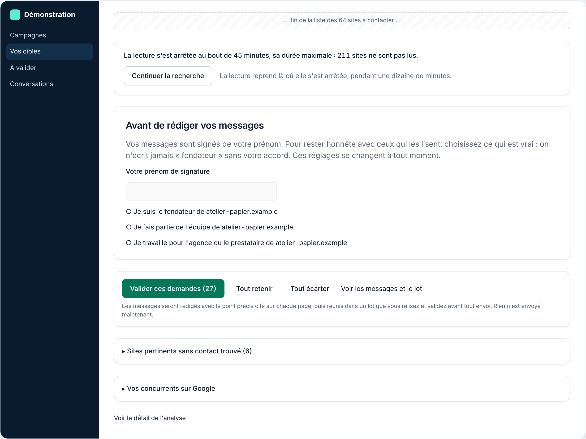
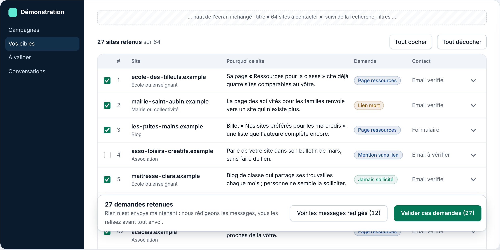
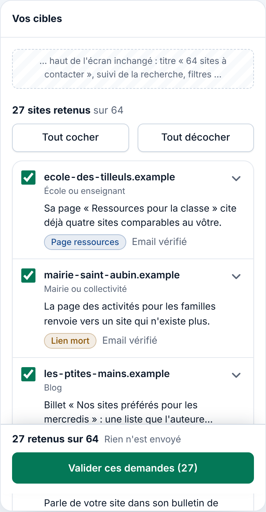
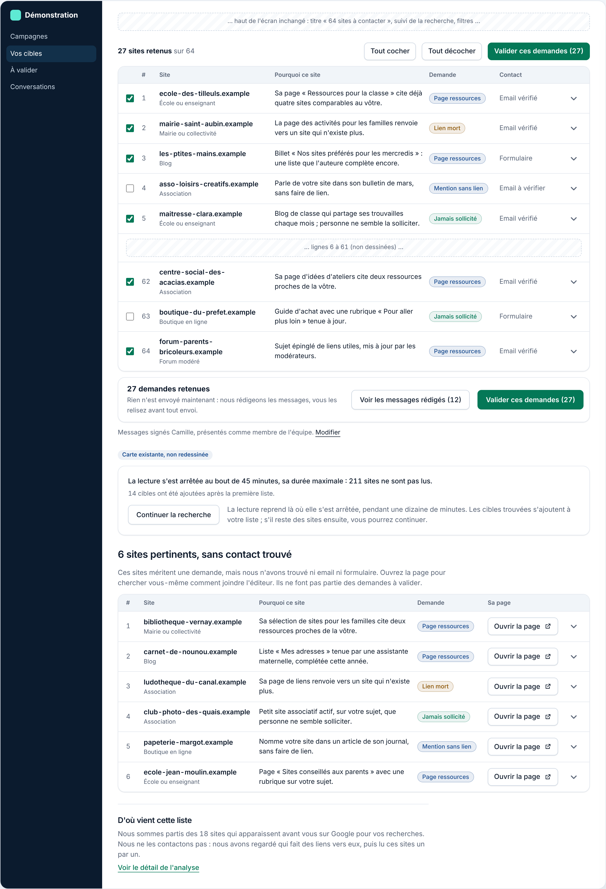

# Maquette « Vos cibles », bas de l'écran (18/11/2026)

**À valider par Jonathan avant tout codage.** Fichier : `docs/mockups/vos-cibles-bas.html` (à ouvrir dans un navigateur ; captures ci-dessous). Rien n'est branché, aucun fichier de `src/` n'est modifié. Données de démonstration, domaines en « .example ».

Point de départ : le bas de `src/features/targets/targets-screen.tsx` tel qu'il est dans `main` après la PR 172.

## Constat (avant)

Reconstitution d'après le code, pas une capture du produit.

1. **« Sites pertinents sans contact trouvé (N) » est un bloc replié**, avec une liste en texte simple. Pourtant le produit connaît pour chacun le site, son type, la raison, la demande et l'adresse de la page lue : de quoi les montrer comme les autres cibles.
2. **« Vos concurrents sur Google » est un bloc replié sans rôle ici** : une liste de sites, combien de recherches, la meilleure place. Rien à faire avec, sur un écran où l'on choisit qui contacter.
3. **La barre collante mélange tout** : un bouton vert, deux mots sans cadre (« Tout retenir », « Tout écarter ») qui ne ressemblent pas à des boutons, un lien souligné « Voir les messages et le lot » (jargon), puis deux lignes d'explication en petit. Sur téléphone, le lien disparaît.
4. **« Avant de rédiger vos messages » est posé dans la page** (retour de Jonathan pendant la maquette : « section pas pertinente ici »). Le formulaire apparaît entre la carte de lecture et la barre, comme une section de plus.
5. **L'ordre ne raconte rien** : carte de lecture, formulaire, barre, deux blocs repliés, lien.

## Proposition (variante A, recommandée)

| Bureau, pendant le défilement                   | Téléphone, pendant le défilement                |
| ----------------------------------------------- | ----------------------------------------------- |
|  |  |

Le bas de page en entier : [bureau](img/vos-cibles-bas-a-bureau.png), [téléphone](img/vos-cibles-bas-a-mobile.png).

| Choix                                                                                                                                                                                                                                               | Répond à |
| --------------------------------------------------------------------------------------------------------------------------------------------------------------------------------------------------------------------------------------------------- | -------- |
| **Choisir et valider sont séparés.** Au-dessus de la liste : « 27 sites retenus sur 64 » et deux vrais boutons à contour, « Tout cocher » et « Tout décocher » (côte à côte, pleine largeur sur téléphone).                                         | 3        |
| **Une barre, une seule action verte** : « Valider ces demandes (27) ». À gauche, le compteur et une phrase : « Rien n'est envoyé maintenant : nous rédigeons les messages, vous les relisez avant tout envoi. »                                     | 3        |
| **La barre suit la liste, puis se pose.** Elle reste en bas de l'écran tant qu'on parcourt les cibles ; en fin de liste elle se range sous le tableau et ne recouvre plus la suite.                                                                 | 3, 5     |
| **Sur téléphone**, la barre est collée au bord bas, sur toute la largeur : compteur sur une ligne, bouton vert de 44 px. Le bouton secondaire passe sous la liste.                                                                                  | 3        |
| **« Voir les messages et le lot » devient « Voir les messages rédigés (12) »**, vrai bouton à contour, affiché seulement s'il existe déjà des messages. Le mot « lot » disparaît des textes.                                                        | 3        |
| **Aucune demande cochée** : le bouton vert est grisé et la phrase devient « Cochez au moins un site. »                                                                                                                                              | 3        |
| **Les sites sans contact deviennent une vraie section**, « 6 sites pertinents, sans contact trouvé », avec les mêmes lignes que la liste (site, type, raison, demande, détail au clic). Pas de case à cocher : ils ne font pas partie des demandes. | 1        |
| **Un bouton « Ouvrir la page » sur chaque ligne** (nouvel onglet) mène à la page que nous avons lue, pour y chercher soi-même un contact.                                                                                                           | 1        |
| **« Vos concurrents sur Google » quitte cet écran.** À la place, deux phrases « D'où vient cette liste » et le lien « Voir le détail de l'analyse », où la liste des concurrents a sa place.                                                        | 2        |
| **« Avant de rédiger vos messages » devient une fenêtre** (« Qui signe vos messages »), ouverte au clic sur « Valider ces demandes » et seulement si le prénom ou le rôle manque. Sur téléphone, un panneau qui monte du bas.                       | 4        |
| **Ordre du bas de page** : liste, barre, rappel de signature, carte de la lecture des autres sites (inchangée), sites sans contact, origine de la liste.                                                                                            | 5        |

Fenêtre de signature : [bureau](img/vos-cibles-bas-signature-bureau.png), [téléphone](img/vos-cibles-bas-signature-mobile.png).

### Recommandation sur les concurrents

**Les retirer de cet écran.** La liste n'aide aucune décision ici, et on ne contacte pas ces sites. Ce qu'il faut garder, c'est l'explication (« nous sommes partis des sites placés avant vous sur Google, nous avons regardé qui fait des liens vers eux ») : elle rassure sur l'origine des cibles et tient en deux phrases. Le tableau complet va dans le détail de l'analyse.

Autre option, écartée : garder le bloc et lui donner un rôle (par exemple « retirer un concurrent qui n'en est pas un »). Le produit ne sait pas le faire à cette étape, et cela relancerait une recherche.

## Variante B : pas de barre collante

Le bouton vert est en haut de la liste, à côté du compteur, et répété en fin de liste ([téléphone](img/vos-cibles-bas-b-mobile.png)). Plus calme, rien ne flotte. Mais avec 64 lignes il faut remonter ou descendre pour valider, et le compteur n'est plus sous les yeux pendant qu'on coche.

**Je recommande A** : l'action reste à portée de main et le compteur réagit à chaque case. Le défaut de la barre actuelle n'était pas d'être collante, c'était d'être chargée.

## Ce que le produit sait déjà fournir, et ce qui manque

- **Sites sans contact** : domaine, type de site, raison, demande, adresse de la page lue, détail déplié. Tout existe. Limite actuelle : 100 sites au plus ; au-delà de 10, prévoir un bouton « Afficher les N autres ».
- **« Mentions sans lien, sans contact trouvé »** : aujourd'hui une section à part, de même nature. La maquette les range dans la même section (pastille « Mention sans lien »).
- **« Voir les messages rédigés (12) »** : le nombre se déduit des cibles déjà validées ; le lien mène à la page actuelle des messages.
- **« 18 sites qui apparaissent avant vous »** : c'est le nombre de concurrents déjà chargé par l'écran (30 au plus).
- **À ajouter au codage** : le détail de l'analyse n'affiche le tableau des concurrents que pour les anciennes analyses ; il faudra l'y montrer aussi pour les nouvelles.
- **Non dessiné, hors de ce que le produit sait faire** : saisir soi-même un email trouvé pour un site sans contact, ou le marquer « contacté par moi ». Idée pour plus tard.

## Accessibilité

Vrais boutons et vrais liens, focus visible (2 px, vert), contrastes des jetons du projet, cases de 20 px et cibles de 40 à 44 px sur téléphone, compteur annoncé aux lecteurs d'écran, « Ouvrir la page » précise le site et le nouvel onglet. Téléphone : marges de 16 px, aucun défilement horizontal (vérifié par le script de capture).

## Décisions à prendre par Jonathan

1. **Barre** : A (collante, recommandée) ou B (en haut et en fin de liste).
2. **Mots des boutons** : « Tout cocher » et « Tout décocher » (maquette) à la place de « Tout retenir » et « Tout écarter ». « Écarter » laissait croire que les sites étaient supprimés.
3. **Bouton vert** : garder « Valider ces demandes (27) » (maquette), ou dire ce qui se passe, par exemple « Rédiger les 27 messages ».
4. **Concurrents** : les retirer de cet écran et garder les deux phrases « D'où vient cette liste » (recommandé), ou tout retirer et ne laisser que le lien.
5. **Sans contact** : une seule section qui réunit aussi les « mentions sans lien, sans contact » (maquette), ou deux sections comme aujourd'hui.
6. **Signature** : une fenêtre au moment de valider (maquette), ou la demander plus tôt, une fois pour toutes, à l'inscription du site.
